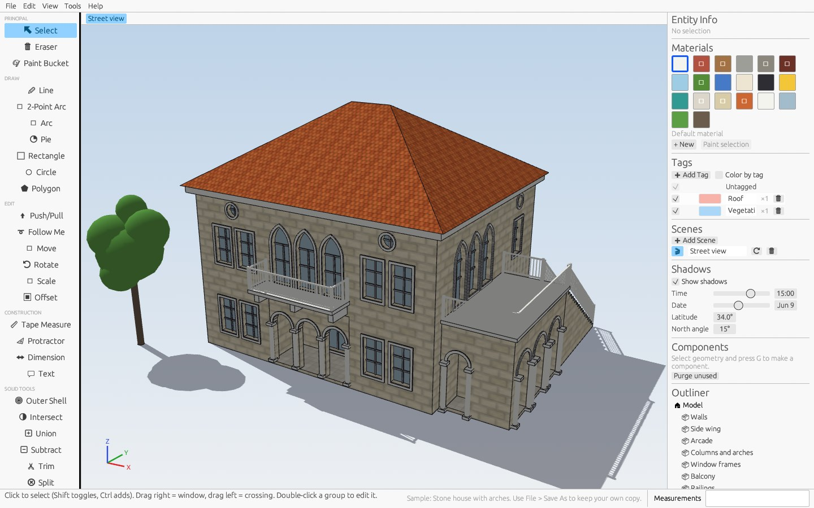

# OpenSketch

[](https://github.com/Khaldoun-Baz/opensketch/actions/workflows/ci.yml)
[](LICENSE)
[](CONTRIBUTING.md)

An open-source, SketchUp-style push/pull 3D modeler written in Rust (egui + OpenGL).
Draw on the ground or on faces, push/pull shapes into 3D, and build with groups,
components, guides, dimensions, textures and shadows.

**Website:** <https://khaldoun-baz.github.io/opensketch/> ·
**Questions and ideas:** [Discussions](https://github.com/Khaldoun-Baz/opensketch/discussions)



More pictures on the [website](https://khaldoun-baz.github.io/opensketch/#gallery).

## Download

Ready-to-run builds for Windows, macOS (Apple Silicon) and Linux are on the
[Releases page](https://github.com/Khaldoun-Baz/opensketch/releases/latest).
See [CHANGELOG.md](CHANGELOG.md) for what's new.

## Building from source

Requires Rust stable (1.88+) from <https://rustup.rs>.

```bash
cargo run --release
```

Open a model or a sample straight from the command line:

```bash
cargo run --release -- my-house.osk
cargo run --release -- --sample stone-house
```

On Linux, first install the windowing libraries:

```bash
sudo apt-get install libxcb-render0-dev libxcb-shape0-dev libxcb-xfixes0-dev libxkbcommon-dev libssl-dev
```

## What works today

| Area | Features |
|---|---|
| Drawing | Line (L), 2-Point Arc (A), Arc (center), Pie, Rectangle (R), Circle (C), Polygon (N) — on the ground, on faces, or on locked vertical planes. Arcs/circles are curves (select as one), arcs close and split faces; type `5r` radius, `12s` segments |
| Follow Me | Select a path (edges or a face outline), click the profile face: mitred sweeps along open paths, rings and lathe/revolve along closed paths |
| Intersections | Coplanar edges split where they cross; overlapping shapes, lines across faces and shapes touching a face's edge divide faces into proper regions (no overlapping faces). Edit ▸ Intersect Faces ▸ With Model / With Selection cuts edges where faces and groups/components cross |
| Smoothing | Shallow-angle seams from push/pull and Follow Me become soft edges (hidden) with smooth shading; View ▸ Hidden Geometry shows them |
| Groups & Components | Make Group (Ctrl+G), Make Component (G), double-click to edit in place (rest of the model fades; Esc or click outside closes), Explode, Make Unique, convert group → component, Components panel with Place, Outliner tree, nested groups, paint/move/rotate/scale/copy/erase whole instances |
| Editing | Push/Pull (P), Move (M, Ctrl = copy, `3x` / `/3` arrays), Rotate (Q, 15° snaps), Scale (S, uniform or `x,y,z`), Offset (F), Eraser (E), Paint Bucket (B, Alt = sample) |
| Handling | Tools work click-move-click or press-drag-release, and a wobble of the mouse during a click no longer makes tiny stray geometry. Push/Pull: point at a corner, edge or parallel face to stop level with it; double-click a face to repeat the last distance. Move: with nothing selected it picks up what is under the cursor (a corner point to stretch, an edge, a face or a group, highlighted first) for that one move; what you move never snaps to its own old position; faces that stop being flat fold along new edges (auto-fold). 2-point arcs snap to a half circle and to tangents (cyan, "Tangent at Vertex") |
| Sticky geometry | Shared vertices/edges, auto-faces from closed coplanar loops, lines split faces, shapes drawn inside faces become holes, coplanar faces heal after push/pull or seam erase |
| Inference | Endpoint, Midpoint, On Edge, On Face, red/green/blue axis; arrow keys lock axes, Shift holds the current inference. From Point: along an axis, positions line up with points the cursor passed over (dotted line), and a locked axis stops level with the point under the cursor. Parallel / Perpendicular to an edge the cursor passed over (magenta) |
| Measurements box | Type while drawing: `2.5`, `300mm`, `4,3`, `24s`, `45` (degrees). Retype right after Push/Pull, Move, Rotate or Offset to adjust it |
| Camera | Orbit (O / middle-drag), Pan (H / Shift+middle / right-drag), zoom to cursor, Zoom Extents (Shift+Z), standard views, perspective/parallel, X-ray |
| Selection | Click, Shift toggle, Ctrl add, double-click (face + edges), triple-click (connected), window (L→R) and crossing (R→L) boxes |
| Component openings | Make Component (G) on geometry drawn on a face (a window or door rectangle, or a recess pushed into a wall) glues it to the face and cuts an opening: blue axis out of the face, wall healed, hole cut live. Glued components place onto faces, slide only within the face when moved, and the opening follows; Entity Info toggles Glue to faces / Cut opening. Explode and OBJ/STL export make the opening real geometry |
| Solid tools | Outer Shell, Intersect, Union, Subtract, Trim, Split on solid groups/components (closed shells: every edge bounds two faces). Click the first solid, then the second; Outer Shell / Union / Intersect also work on several selected solids. Results are new groups with coplanar seams cleaned up; Entity Info shows whether an instance is a solid and its volume |
| Guides | Tape Measure (T): click a point and measure (adds a guide point), or start on an edge / guide line and move off it for a parallel guide line (click twice in place for a guide on the edge); type a distance; Ctrl toggles measure-only. Protractor: center (aligns to the hovered face, arrow keys lock a plane), baseline, then angle with 15° snaps, or type `30` or a slope `1:2`. Guides are snapped to (On Guide, Guide Point, Intersection with edges and other guides), can be selected, moved/copied, erased, hidden (View ▸ Guides) and cleared (Edit ▸ Delete Guides); saved in the file, not exported |
| Tags & Scenes | Tags panel: add, rename, recolor, hide/show and delete tags; assign a tag to selected groups/components in Entity Info (➕ makes a new one). Hidden tags hide their instances (not while you edit inside one); View ▸ Color by Tag. Scenes panel / View menu: Add Scene saves the camera, hidden tags and display settings (X-ray, hidden geometry, guides, axes, color by tag); scene tabs above the viewport and PgDn/PgUp switch scenes with an animated camera; ⟳ updates a scene. Saved in the file |
| Dimensions & Text | Dimension: click two points (or an edge), move out to offset the dimension line along a plane facing you, click; click an arc or circle for its radius (R) or diameter (Ø). Text: click a face / edge / point for leader text that starts as its area / length / coordinates, or empty space for screen text. Labels follow the display units; edit text in Entity Info (`<>` = measured value). Select, Move/copy, erase, hide (View ▸ Dimensions & Text); saved in the file and in scenes |
| Textures | Built-in procedural textures (brick, wood planks, roof shingles, grass, cobblestone, floor tiles) on the default materials, or Materials ▸ Load image… (PNG/JPEG, embedded in the `.osk` file). Real-world texture size per material; textures are projected onto each face's plane and stay put on groups. Painted faces show their material on both sides. OBJ export writes the texture PNGs (`map_Kd`) and UVs |
| Shadows | Shadows panel (or View ▸ Shadows): time of day, date, latitude and north angle drive the sun; shadow-mapped shadows on faces and on the ground (even where there is no ground face), sun-based shading. Saved in the file and in scenes |
| AI Render | File ▸ AI Render… turns the current view into a hyper-realistic picture with an AI image model. Bring your own account: OpenAI (or any compatible service), Google Gemini, Stability AI, or a Stable Diffusion running on your own PC (AUTOMATIC1111 / Forge, free and private). The address, model name and extra request options are editable, so new models work without a new release. Describe the scene, pick a style (daylight, golden hour, overcast, dusk, interior, aerial, watercolor, pencil, clay model) and how strictly the model's shape is kept; compare with your view and save as PNG. See [AI Render](#ai-render) |
| Samples | File ▸ Samples ▸ *Stone house with arches*: a two-storey limestone house with an arcaded loggia, pointed-arch windows, a balcony, a side terrace with outside stairs, a hipped clay-tile roof and a tree, built from groups you can open and edit. Opens as an unsaved copy: File ▸ Save As keeps it |
| Files | Native `.osk` (JSON), OBJ import, OBJ (+MTL) and STL export, undo/redo (Ctrl+Z / Ctrl+Y) |

## Code map

- `src/document.rs` — definitions/instances (groups & components), edit contexts, explode, flatten for export
- `src/model.rs` — geometry kernel: vertices/edges/faces with holes, face splitting, loop detection, push/pull, offset, healing, triangulation (unit tests at the bottom)
- `src/solid.rs` — solid check, volume and booleans (Union / Intersect / Subtract) for the Solid Tools
- `src/guide.rs` — guide lines/points, their intersections and dashed drawing
- `src/texture.rs` — built-in procedural textures, image textures (embedded as base64), UV projection
- `src/sun.rs` — sun position from time/date/latitude, shadow-map light frustum
- `src/inference.rs` — snapping and picking
- `src/ai.rs` — AI Render: prompt, picture preparation, the requests for each image service and their answers (tested against a local fake server)
- `src/app.rs` — UI, tools, Measurements box, selection
- `src/render.rs` — OpenGL renderer: plain and textured face batches, shadow-map pass, ground shadows, edges
- `src/camera.rs`, `src/units.rs`, `src/io.rs`

## Roadmap (next SketchUp features)

1. Component axes tool, Edit ▸ Paste in Place, openings cutting through thick walls
2. Position Texture (move/rotate/scale a texture on a face), styles (sketchy edges, watermarks)
3. Dimensions that stay attached to geometry when it moves

## AI Render

**File ▸ AI Render…** sends a picture of the current view and your description
to an AI image model and shows the result next to your model.

1. Pick a **service** and paste your own **API key** (the window links to the
   page where each service hands them out). For *Stable Diffusion on this PC*,
   start the web UI with `--api`; no key is needed and nothing leaves your computer.
2. Set up the camera in the main window, describe the scene, choose a style, click **Render**.
3. Switch between **AI render** and **Your view**, then **Save image…**.

Good to know:

- OpenSketch has no AI account of its own: the services bill your account per picture.
- Guides, axes, dimensions and the selection are left out of the picture that is sent.
- **Connection (advanced)** holds the address, the model name and extra options
  (`name=value`, one per line, e.g. `quality=high` or `seed=42`). Model names
  change often: if a service rejects the default, type a current one there.
- Settings and keys are kept in `ai.json` in your user settings folder
  (`%APPDATA%\OpenSketch`, `~/Library/Application Support/OpenSketch` or
  `~/.config/opensketch`), never in the model file. Untick *Remember API keys*
  to keep keys out of that file, or set `OPENSKETCH_AI_KEY` instead.
- AI pictures are for presentation: details can differ from the model.

## Rendering self-test

`OPENSKETCH_SHOT=shot.png cargo run` opens a small textured, sunlit demo scene,
saves the 3D view to `shot.png` and exits (add `OPENSKETCH_SHOT_NO_GROUND=1` to
check ground shadows without a ground face). Handy for checking rendering
changes without clicking through the UI.

`OPENSKETCH_DEMO=1 cargo run` starts with that demo scene and stays open.

`OPENSKETCH_SCRIPT=steps.txt cargo run` plays mouse and keyboard input from a
file, one step per frame, to test how tools handle without a person at the
mouse. Steps: `text r`, `move 500 400`, `click`, `down`, `up`, `drag 700 500`,
`key enter` (also `escape`, `delete`, arrows, `ctrl+z`), `wait 5`,
`shot window.png` (whole window), `dump state.txt` (vertex / edge / face
counts, bounds, selection, tool state) and `quit`. Positions are window points.
`OPENSKETCH_SHOT_AI=window.png cargo run` opens AI Render on it, renders once
with the saved settings, saves a picture of the whole window and exits (point
`OPENSKETCH_CONFIG_DIR` at a folder whose `ai.json` targets a local test server).

## Author

Created and maintained by **Khaldoun Baz** ([@Khaldoun-Baz](https://github.com/Khaldoun-Baz)).
See the [contributors graph](https://github.com/Khaldoun-Baz/opensketch/graphs/contributors) for everyone who has helped.

## Contributing

Contributions are welcome: bug reports, feature ideas, docs and code. Read
[CONTRIBUTING.md](CONTRIBUTING.md) to get started, and check the issues labeled
**good first issue**. Questions and ideas are welcome in
[Discussions](https://github.com/Khaldoun-Baz/opensketch/discussions). Please
follow the [Code of Conduct](CODE_OF_CONDUCT.md).

## License

[MIT](LICENSE). OpenSketch is an independent project and is not affiliated with
or endorsed by Trimble or SketchUp.
